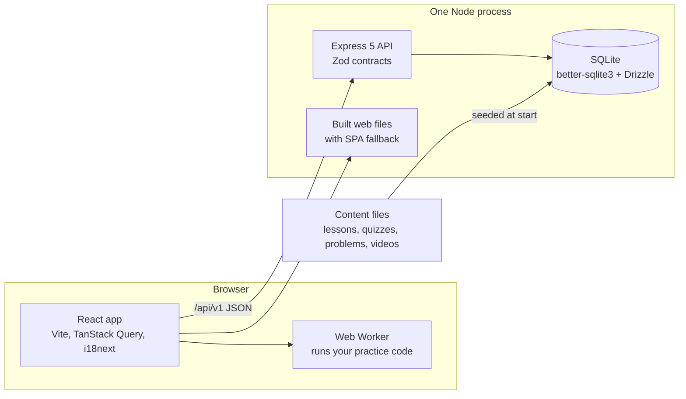
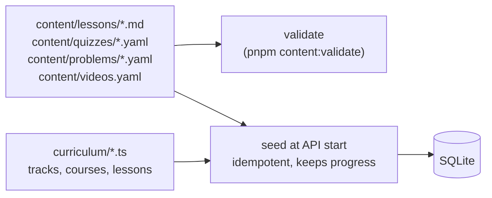

# Architecture

Developer Learning OS is a single-owner web app. A React front end talks to an Express API that stores everything in one SQLite file. Lessons, quizzes, problems and videos are plain files in the repository that are loaded into the database when the API starts.

In development the two halves run separately: Vite serves the web app on port 5173 and proxies `/api` to the API on port 4000. In production one process does both, because the API can serve the built web app (`WEB_DIST_DIR`).

## Repository layout

| Path | What it holds |
| --- | --- |
| `apps/api` | Express 5 API, Drizzle schema and migrations, seeding, services per feature |
| `apps/web` | React single-page app, tests, Playwright end-to-end specs |
| `packages/shared` | Zod schemas, the endpoint contracts, constants, date helpers and the practice test harness. Used by both apps |
| `packages/ui` | Design system: components, Tailwind 4 theme tokens (light and dark) |
| `packages/learning-content` | The curriculum (tracks, courses, modules, lesson titles), the 24-week roadmap, AI labs, the content files and the validation tool |
| `packages/config` | Shared TypeScript configuration |
| `scripts` | `smoke.mjs` (checks a running instance) and `check-licenses.mjs` |

## Contract first

Every endpoint is described once in `packages/shared/src/contracts/endpoints.ts` with `defineEndpoint`: method, path, and Zod schemas for params, query, body and response. Three things are derived from that single description:

- the API registers each route with `registerRoute`, which validates the request, runs the handler and checks the response against the schema,
- the OpenAPI document (`/api/openapi.json`, Swagger UI at `/api/docs`) is generated from the same contracts, and a test makes sure every endpoint appears in it,
- the web app calls the API through typed helpers, so a changed field is a compile error instead of a runtime surprise.

## API

`apps/api/src/features/<name>` holds one folder per feature (`curriculum`, `plan`, `study`, `dashboard`, `practice`, `quizzes`, `search`, `projects`, `calendar`, `activity`, `preferences`, `health`). Each has a service with plain functions that take the app context (database, clock, config, logger, owner id) and return data that matches the contract. `features/routes.ts` wires services to endpoints. The clock is injected, so tests can pin "today".

Cross-cutting behaviour lives in `core/http/middleware.ts`:

| Guard | Purpose |
| --- | --- |
| `hostGuard` | Rejects unexpected `Host` headers, so a DNS-rebinding page cannot reach a local API |
| `originGuard` | State-changing requests from a browser must come from an allowed origin |
| `cors`, `helmet`, rate limit | Standard hardening. The referrer policy keeps the origin because YouTube refuses embeds without a referrer |
| `jsonBodyGuard`, 100 kb limit | Bodies must be JSON and small |
| `basicAuth` (optional) | HTTP Basic sign-in for deployments, with a lock-out after repeated failures. The health check stays open |

## Data

SQLite through `better-sqlite3` and Drizzle ORM. Migrations are plain SQL in `apps/api/drizzle` and run automatically when the API starts (`AUTO_MIGRATE`). The schema is in `apps/api/src/core/db/schema`:

| File | Tables |
| --- | --- |
| `users.ts` | `users`, `user_preferences`, `ai_settings` |
| `curriculum.ts` | `learning_tracks`, `courses`, `modules`, `lessons`, `lesson_translations` |
| `plan.ts` | `study_plans`, `study_plan_weeks`, `study_plan_tasks` |
| `progress.ts` | `lesson_progress`, `progress_events`, `study_sessions` |
| `assessments.ts` | `quizzes`, `quiz_questions`, `quiz_attempts`, `coding_problems`, `coding_attempts`, `review_schedules` |
| `projects.ts` | `projects`, `project_milestones`, `user_projects`, `user_project_milestones` |
| `resources.ts` | `learning_resources`, `resource_verifications`, `lesson_resources` (videos and links, with verification state) |
| `knowledge.ts`, `interviews.ts` | `notes`, `bookmarks`, `tags`, `taggings`, `flashcards`, `interviews`, `interview_attempts`, `diagrams`. Reserved for features that are planned, not built yet |

Progress is never stored as a number that someone typed in. Streaks, hours, weekly charts and readiness are computed from `study_sessions`, `progress_events`, `lesson_progress` and task completions.

## Content pipeline

- The curriculum in `packages/learning-content/src/curriculum` lists every lesson title. A lesson with a Markdown file is **complete**. One without a file stays **planned** and cannot be completed.
- `validate` checks that every file matches its schema, that video ids exist in the registry, that heading anchors are unique, that every reference solution passes all its tests and that every starter fails at least one. The same check runs in CI.
- Seeding runs at every API start. It updates the content records in place and never touches your progress. That is why you restart the API after editing a content file.
- Videos are listed in `videos.yaml`. `pnpm content:videos` asks YouTube's oEmbed endpoint whether each video exists and may be embedded, then stores the verified title and author.
- The English track is self-paced and exempt from the 24-week roadmap. Every other lesson must be scheduled in the roadmap, so completing it can tick its plan task.

## Practice runner

The editor is CodeMirror 6. When you press Run or Submit:

1. The TypeScript is transpiled with `sucrase` (types are erased, nothing is type-checked).
2. A module Web Worker (`runner.worker.ts`) compiles the code with `new Function` and runs the tests one by one through the shared harness in `@dlos/shared`.
3. The page stops the worker if one test takes longer than 2 seconds, so an infinite loop cannot freeze the tab.
4. The result (passed count, status, runtime) is posted to the API, which stores the attempt and updates the solved status. A first solve is reported back so the UI can celebrate it.

The same harness runs in Node during `pnpm content:validate`, so a broken reference solution is caught before it reaches the browser. Linked lists and trees use `list` and `tree` codecs, so test data stays JSON.

Run is limited to the visible example tests. Submit runs every test, including the hidden ones. Hidden only means "not shown in the interface": they are part of the problem payload, because the code runs in your browser. This is a learning tool for one person, not a judge.

## Web app

- `react-router` with lazy route modules (`Component` exports), so CodeMirror and the Markdown renderer load only when needed.
- TanStack Query for server state, Zustand for UI state (language, theme, sidebar, automatic study timer). The UI state is persisted under `dlos-ui`, and `public/theme-init.js` reads it before first paint to avoid a flash of the wrong theme.
- i18next with typed keys in three locales (`en`, `hi-Latn` for Hinglish, `hi`). A key that is missing in one locale is a compile error. Lesson text is English only, and the page says so when it falls back.
- Lessons render Markdown without raw HTML. Fenced `phrases` blocks become speaking-practice lists (browser speech synthesis to listen, `MediaRecorder` to record, kept in the tab), tables get a CSV download, and print styles produce clean PDFs.
- Time spent on a lesson or problem is logged as a study session automatically (visible tab only). It can be switched off in Settings.
- Accessibility: Playwright runs axe (WCAG 2.2 AA) on every main page in both themes and three languages, and checks that no page scrolls horizontally from 320 px to 1440 px.

## Security model

The app assumes one trusted owner. Keep that in mind when you host it:

- **No user accounts.** Anyone who can reach the app can read and change the data. Turn on `BASIC_AUTH_USER` and `BASIC_AUTH_PASSWORD`, or put it behind a proxy that signs users in, before it is reachable from the internet.
- The API only accepts expected `Host` and `Origin` headers (`PUBLIC_URL`, `ALLOWED_HOSTS`, `ALLOWED_ORIGINS`).
- The web app is served with a Content Security Policy: scripts only from the same origin, frames only from `youtube-nocookie.com`, and `unsafe-eval` only for the practice worker script.
- Learner code runs in a worker, so it cannot touch the page. In the hosted build the worker's policy also limits network access to the same origin. Still, treat code you paste from strangers with care.
- Videos load only after a click, from the privacy-enhanced YouTube domain.
- The Docker image runs as a non-root user. Dependencies are installed from the lockfile, and `pnpm licenses:check` keeps the licences permissive.
